

  <a href="https://galasulin.github.io/clinic-crm/">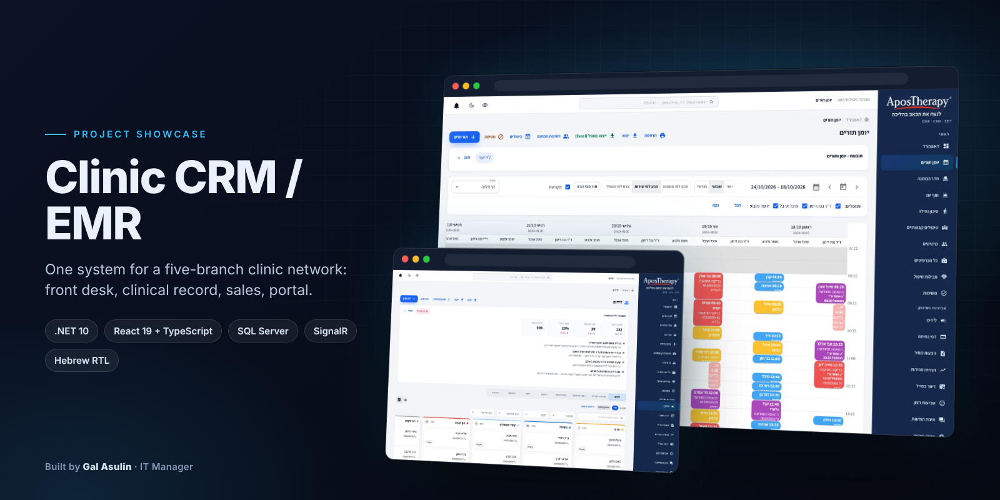</a>

<h1 align="center">Clinic CRM / EMR</h1>

  <b>מערכת אחת שמנהלת רשת מכונים עם חמישה סניפים: קבלה, מוקד, תיק רפואי, מכירות, שיווק ופורטל מטופלים.</b> 
  תכנון ובנייה מקצה לקצה של אדם אחד. מותקנת על שרתי הארגון. עברית ו-RTL מהיסוד.

  <a href="README.md">🇬🇧 English</a> · <b>🇮🇱 עברית</b>

  <a href="https://galasulin.github.io/clinic-crm/"><b>▶ לדף החי: טריילר של 2:18 דקות ומסכים</b></a> ·
  <a href="#-מסכים">מסכים</a> ·
  <a href="#-מה-מבדיל-אותה">מה מבדיל אותה</a> ·
  <a href="#-ארכיטקטורה">ארכיטקטורה</a> ·
  <a href="#-פרמטרים-טכניים">פרמטרים טכניים</a>

  
  
  
  
  
  
  
  

> 🔒 **תצוגה, לא קוד מקור.** הקוד וכל הנתונים האמיתיים פרטיים. כל המסכים והטריילר צולמו מ**מופע הדגמה מקומי ומבודד** שנבנה מקוד הייצור, עם אנשים ומספרים בדויים, ושליחת SMS, מייל ווואטסאפ חסומה בו. שום דבר כאן לא מגיע מהייצור.

---

## 📊 במבט מהיר

| | |
|---|---|
| **מה זה** | CRM, תיק רפואי (EMR), קבלה ופורטל מטופלים לרשת מכוני פיזיותרפיה עם כמה סניפים |
| **מצב** | מבצעית: מותקנת בייצור מיולי 2026, והצוותים עובדים בה |
| **היקף הבנייה** | יותר מ-140 בקרי API · יותר מ-110 ישויות · כ-100 מסכים · 26 רכיבים בעורך דפי הנחיתה · 47 שיעורים במדריך המובנה |
| **טכנולוגיה** | ASP.NET Core Web API על ‎.NET 10 LTS · EF Core · SQL Server · SignalR · React 19 · TypeScript · Vite · MUI |
| **אירוח** | על שרתי Windows של הארגון, IIS כ-reverse proxy לפני Kestrel |
| **שפה ועיצוב** | עברית ו-RTL מהיסוד, ערכת בהירה וכהה משכבת design tokens אחת |
| **התפקיד שלי** | הכול: אפיון, מודל נתונים, צד שרת, צד לקוח, מערכת עיצוב, אינטגרציות, התקנה וגיבויים |
| **רישום העבודה** | 1,305 דרישות במעקב · 876 נסגרו עם ראיה חיה · עוד 194 הוכחו בסביבה מבודדת (נובמבר 2026) |

---

## 📸 מסכים

<table>
<tr>
<td width="25%" valign="top"><a href="assets/screens/01-home_light.webp">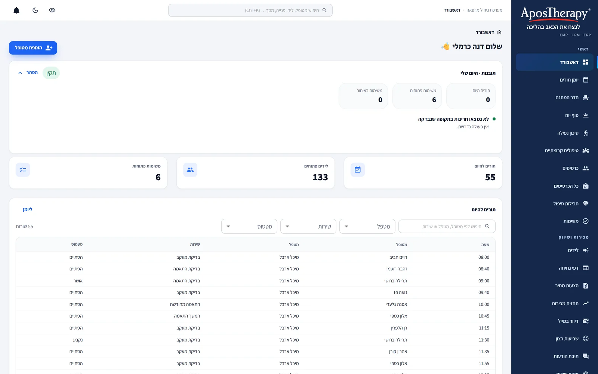</a> <b>דאשבורד</b> התורים, המשימות והלידים של היום.</td>
<td width="25%" valign="top"><a href="assets/screens/02-schedule_week_light.webp">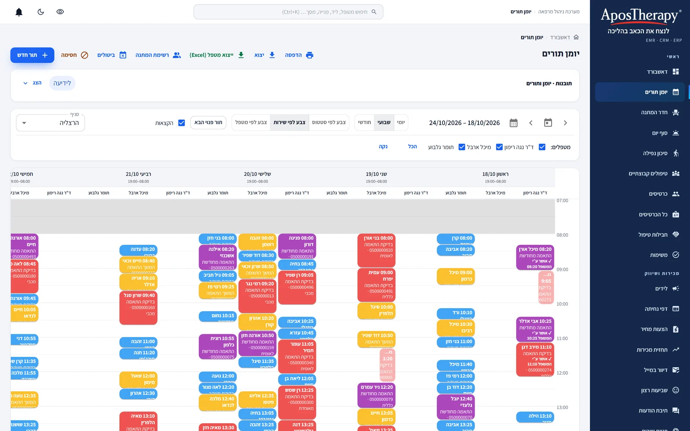</a> <b>יומן תורים</b> לפי מטפל, חדר וסניף. תור זז בגרירה.</td>
<td width="25%" valign="top"><a href="assets/screens/03-patient_light.webp">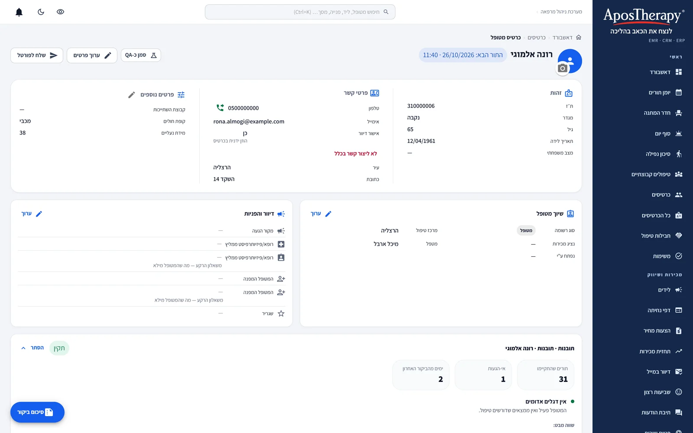</a> <b>כרטיס מטופל</b> חיפוש אחד, וכל הכרטיס פתוח.</td>
<td width="25%" valign="top"><a href="assets/screens/06-leads_kanban_light.webp">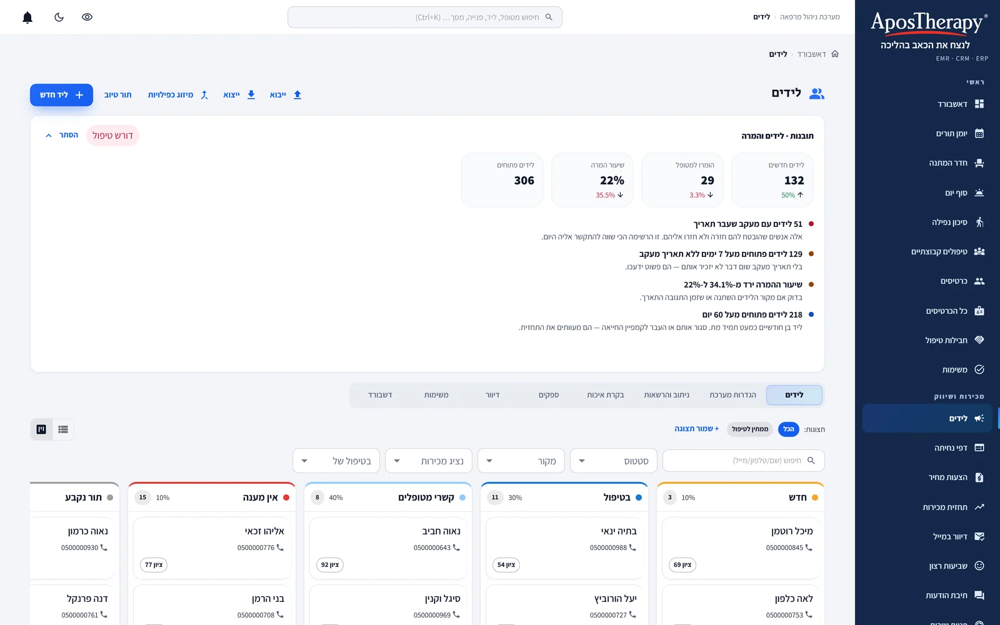</a> <b>לידים</b> רשימה או לוח, לפי שלבי המכירה.</td>
</tr>
<tr>
<td width="25%" valign="top"><a href="assets/screens/07-gait_compare_light.webp">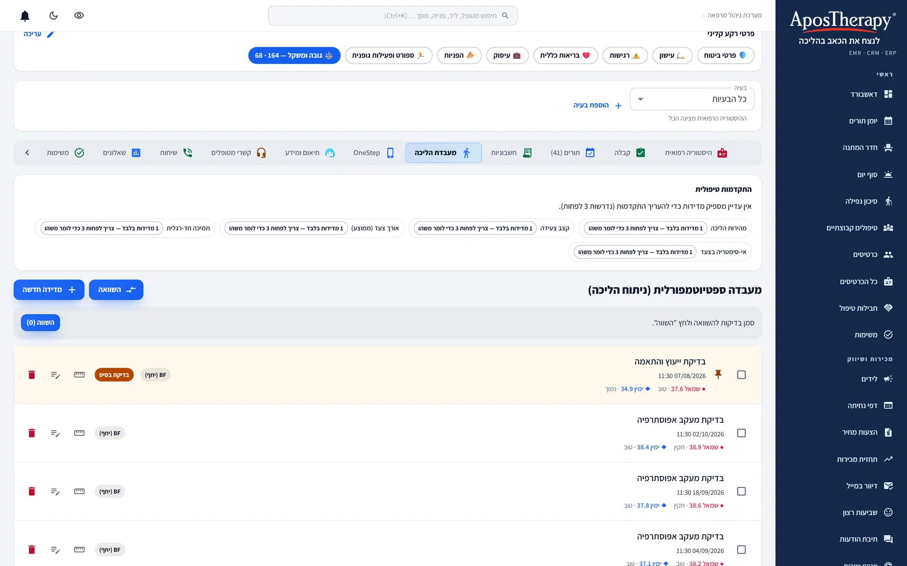</a> <b>מעבדת הליכה</b> כל מדד מול הנורמה ומול בדיקת הבסיס.</td>
<td width="25%" valign="top"><a href="assets/screens/08-form_builder_light.webp">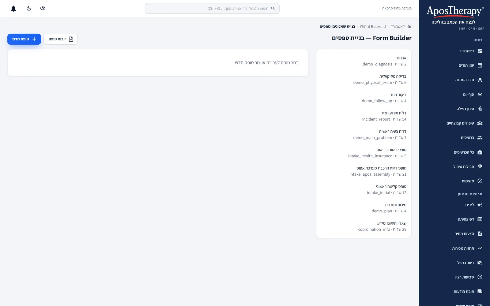</a> <b>טפסים קליניים</b> שדות, שדות חובה וחתימה.</td>
<td width="25%" valign="top"><a href="assets/screens/04-sales_forecast_light.webp">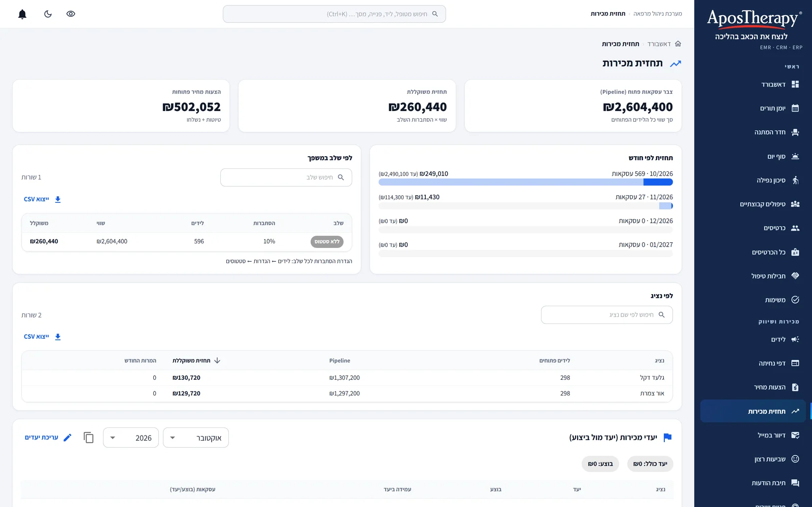</a> <b>תחזית מכירות</b> כל עסקה משוקללת לפי הסיכוי שלה.</td>
<td width="25%" valign="top"><a href="assets/screens/05-access_light.webp">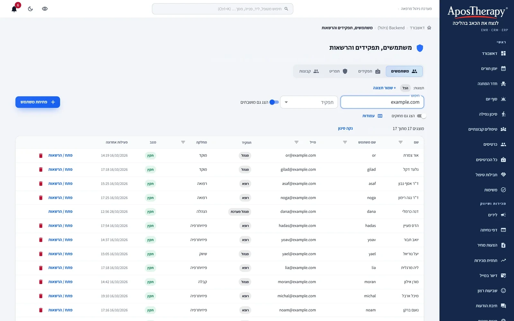</a> <b>משתמשים והרשאות</b> לפי תפקיד, קבוצה ומשתמש.</td>
</tr>
</table>

לחיצה על מסך פותחת אותו בגודל מלא. ב<a href="https://galasulin.github.io/clinic-crm/">דף החי</a> מתנגן טריילר ההשקה (גרסת תצוגה מקדימה).

---

## 🚀 מה מבדיל אותה

ברוב המרפאות יש כלי ליומן, תיק רפואי נפרד, כלי לידים נפרד, גיליון אקסל למכירות ומרכזייה שלא מכירה אף אחד מהם. המערכת הזאת מחליפה את כולם במודל נתונים אחד.

| | מה זה אומר בפועל |
|---|---|
| **מנועים, לא מסכים** | טפסים קליניים, הטקסט שהם מפיקים, אוטומציות, תבניות מסמכים, דוחות ודפי נחיתה הם **נתונים** שנערכים במסכי ההגדרות. טופס חדש או דוח חדש לא דורשים קוד ולא דורשים גרסה. |
| **קליני ומסחרי ברשומה אחת** | אותו אדם עובר מליד ללקוח פוטנציאלי ולמטופל **בלי להקליד שוב**. השיחה שפתחה את הליד, הקמפיין שהביא אותו, הביקורים, מדידות ההליכה והחבילה שנרכשה נמצאים על ציר אחד. |
| **טפסים שכותבים את הטקסט הקליני** | המטפל עונה על שאלות מובנות, והמנוע מרכיב מהתשובות אנמנזה רציפה בעברית (שדות מוזרקים, משפטים מותנים ולולאות). הטקסט נשאר פתוח לעריכה, לחתימה ולייצוא. |
| **מעבדת הליכה בתוך התיק** | מדדי ההליכה נשמרים לכל בדיקה ונבחנים מול הנורמה הקלינית, ובדיקות המעקב מושוות לבדיקת הבסיס זו לצד זו. מדידות מאפליקציית ניתוח התנועה שבטלפון של המטופל מגיעות לאותו כרטיס. |
| **טלפוניה שמכירה את המטופל** | כל שיחה נכנסת ויוצאת מהמרכזייה בענן מקושרת לכרטיס המטופל או הליד, עם חיוג בלחיצה מתוך הכרטיס. |
| **שיווק במעגל סגור** | עורך דפי נחיתה בגרירה מפרסם דפים שמכניסים לידים ישר לצנרת המכירות עם מקור הפרסום שלהם, ואירועי שלבי הליד חוזרים לפלטפורמת הפרסום דרך ה-Conversions API שלה. |
| **אבטחה שמוכרעת לכל נתיב** | לכל נתיב API יש החלטת הרשאה מפורשת ובדוקה. כל שינוי וכל פתיחה של כרטיס מטופל נרשמים. כל מחיקה ניתנת לשחזור. |
| **ראיה לפני "בוצע"** | שום דבר לא נסגר בלי צילום מסך, תוצאת שאילתה או בדיקה שעוברת. כל גרסה עוברת CI, הרצה מול מסד נתונים נפרד ובדיקה אוטומטית אחרי ההתקנה, שמחזירה לאחור אם משהו נכשל. |

---

## ✅ יכולות המערכת

**קבלה ומוקד**
- יומן לפי מטפל, חדר וסניף; תצוגת יום לפי חדרים (כולל מעבדת ההליכה); גרירת תור למשבצת פנויה; לוח חודשי קטן עם קפיצה ליום; כפתור שמוצא את התור הפנוי הבא.
- חמישה מרכזים, ולכל אחד שעות פעילות וחריגים.
- לוח חדר המתנה: מי הגיע, כמה הוא מחכה, ומי בטיפול.
- לתור שנקבע במערכת, SMS יום לפני עם קישור אישי: אישור הגעה, הוספה ליומן בטלפון, ניווט, או ביטול. ביטול מהקישור פותח משימה לתיאום, וכל ביטול מופיע עם הסיבה ומה כבר טופל.
- תור שהתפנה מוצע לממתין בקישור אישי.
- כל שיחה מהמרכזייה בענן, נכנסת ויוצאת, משויכת לכרטיס המטופל או הליד.
- משימות הצוות ומעקבים, כולל מה שבאיחור.

**מטפלים**
- חיפוש אחד, והכרטיס פתוח.
- הרשומה מסודרת לפי בעיה (למשל ברך ימין), ומילוי טופס קליני כותב את הסיכום.
- טפסים קליניים עם שדות, שדות חובה ושדה חתימה.
- מדדי הליכה מול הנורמה (תקין / טוב / נמוך), והשוואת בדיקות מעקב מול בדיקת הבסיס.
- מדידות מאפליקציית ניתוח התנועה של המטופל בכרטיס, ורשימת מי שהפסיק למדוד.
- מסמכי ביקור כ-PDF נעול עם טביעת אצבע (SHA-256), וגם קובץ Word לעריכה.
- בסוף היום: מה עוד מחכה לתיעוד.

**מכירות ושיווק**
- כל ליד עם המקור שלו, עד הרופא המפנה; ליד מדף נחיתה נכנס ישר עם המקור.
- צנרת מכירות כרשימה או כלוח; מליד ללקוח ולמטופל בלי להקליד שוב.
- עורך דפי נחיתה בגרירה עם 26 רכיבים; הדף זהה לעורך במחשב ובנייד; נרשמים עם מקור הפרסום וייצוא לאקסל.
- לכל קמפיין: תקציב, עלות לליד ואחוז המרה.
- הצעות מחיר והזמנות (מה נשלח ומה אושר), חבילות טיפול עם ניצול וחידוש.

**הנהלה**
- דאשבורד מנהל: לידים, המרות ועומס, במסך אחד.
- בונה דוחות על כל נתון במערכת, ודוחות שמורים.
- תחזית מכירות שמשקללת כל עסקה לפי הסיכוי שלה.

**מטופלים**
- פורטל אישי: כניסה עם תעודת זהות וקוד חד פעמי (תקף 5 דקות, לשימוש אחד); כל מטופל רואה רק את המידע שלו.
- שאלון הרקע מהטלפון, ישר לכרטיס.
- פרטיות, עוגיות ונגישות בכל דף.

**אבטחה ואמינות**
- הרשאות לפי תפקיד, קבוצה ומשתמש; אילו לידים כל תפקיד רואה, השרת אוכף.
- לכל נתיב API יש החלטת הרשאה מפורשת ונבדקת; אימות דו שלבי.
- כל שינוי וכל פתיחת כרטיס נרשמים ביומן ביקורת.
- נעילה אחרי 15 דקות בלי פעילות, וסיום אחרי 8 שעות.
- כל מחיקה עוברת לסל, ואפשר לשחזר.
- גיבוי מלא בכל לילה, ושחזור שנבדק בפועל.
- מדריך מובנה עם 47 שיעורים.

**ועוד במערכת**
- פרשנות AI למדידות סיכון הנפילה, שמוצגת למטפל כהמלצה לא מחייבת.
- מענה לשיחות WhatsApp מתוך תיבת ההודעות המשותפת.
- תור שהתפנה עובר אוטומטית לממתין הבא ברשימת ההמתנה.
- מספרי הקצאה לחשבוניות מול השירות של רשות המסים.
- סקר שביעות רצון אחרי ביקור.

---

## 🧩 מפת המודולים

| תחום | מודולים |
|---|---|
| **קבלה** | יומן (שבוע, יום לפי חדרים, חודש) · חדרים ועמדות · שעות פעילות, חגים וימים סגורים · לוח חדר המתנה · רשימת המתנה · לוח ביטולים · תזכורות |
| **קליני** | כרטיס מטופל · תיק לפי בעיות · בונה טפסים ותבניות לרשומה קלינית · מפת גוף · מעבדת הליכה · מדידות סיכון נפילה · שאלונים · סיכום ביקור (PDF ו-Word) · מסמכים וקבצים · טיפולים קבוצתיים |
| **מוקד ושירות** | יומן שיחות עם קישור לכרטיס · תיבת הודעות משותפת · פניות שירות · משימות ומעקבים · "היום שלי" |
| **מכירות** | לידים (רשימה ולוח) · מקורות ליד ורופאים מפנים · הצעות מחיר · חוזים · חבילות טיפול · מחירונים · תחזית מכירות · אישורים |
| **שיווק** | עורך דפי נחיתה, ספריית מדיה ונרשמים · קמפיינים עם עלות לליד · דיוור במייל · אירועי המרה לפלטפורמת הפרסום |
| **כספים ומלאי** | חשבוניות וקבלות · ישויות משפטיות · גיול חובות · שכר מטפלים · מלאי · רכש |
| **הנהלה** | דשבורד מנהלים · דשבורדים ו-widgets בהתאמה אישית · מחולל דוחות עם דוחות שמורים ומשותפים · תובנות |
| **מול המטופל** | פורטל (תעודת זהות וקוד חד-פעמי) · קישורי אישור וביטול תור · קישורי הצעת תור מרשימת ההמתנה · שאלונים מהטלפון · הצהרות פרטיות, עוגיות ונגישות |
| **פלטפורמה** | משתמשים, תפקידים, קבוצות והרשאות · יומן ביקורת ואירועי כניסה · סשנים · כללי שמירת מידע וסקירתם · סל מחזור · בקשות פרטיות · מתגי יכולות · תבניות וקטלוג הודעות · אוטומציות · ניטור ומרכז בקרה · מפתחות API ו-webhooks · מדריך הדרכה מובנה |

---

## 🧱 ארכיטקטורה

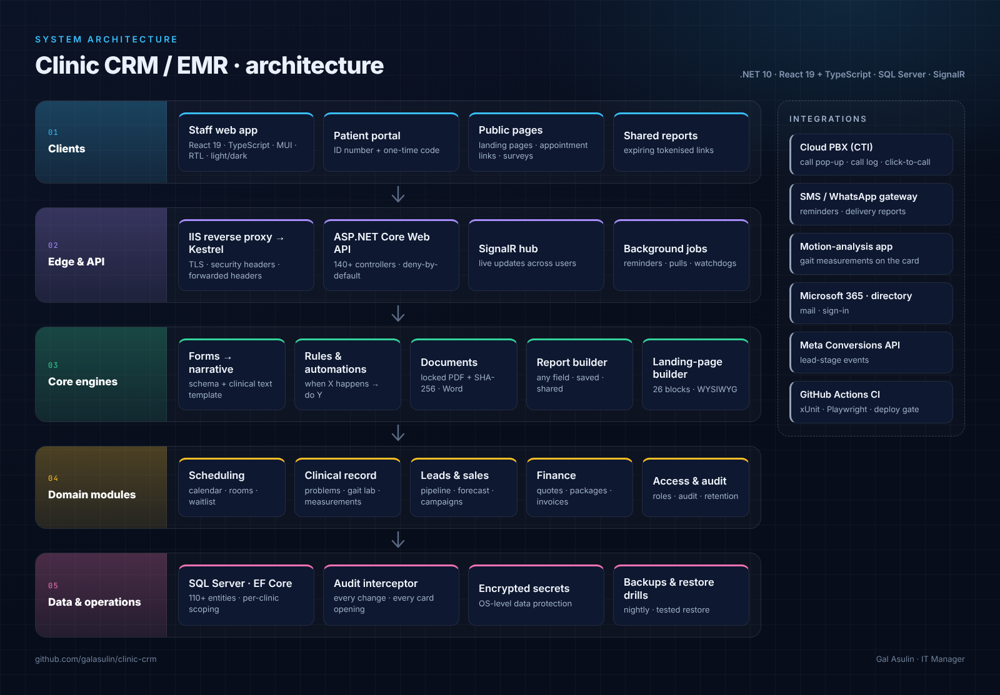

**Clean Architecture** בשלושה פרויקטים: `Api` (בקרים, הרשאות ו-hub לזמן אמת), `Core` (ישויות, חוקים ומנועים) ו-`Infrastructure` (‏EF Core, אינטגרציות ועבודות רקע). מעליהם אפליקציית React בעמוד אחד, ומתחתיהם SQL Server. הכול מותקן על Windows בשרתי הארגון: IIS מסיים את ה-TLS ומעביר ל-Kestrel.

- **אימות.** אסימוני JWT קצרי חיים עם רוטציה של refresh token, שלב שני אופציונלי בכניסה, נעילת מסך אחרי 15 דקות בלי פעילות וסיום סשן אחרי 8 שעות.
- **הרשאות.** ברירת המחדל היא סירוב. כל נתיב מצהיר על ההחלטה שלו, וההחלטות מכוסות בבדיקות. אילו לידים רואה כל תפקיד מסונן בשרת, לא בממשק.
- **ביקורת.** ‏interceptor של EF Core רושם מי, מה, מתי וערך ישן ← חדש לכל שינוי בישות. גם פתיחה של כרטיס מטופל נרשמת. סודות מוסתרים לפני שהם מגיעים ליומן.
- **זמן אמת.** ‏hub של SignalR דוחף אירועי שינוי, כך שיומנים, לוחות וחדר ההמתנה מתעדכנים אצל כל המשתמשים בלי רענון.
- **עבודות רקע.** מנוע עבודות שולח תזכורות בתוך חלון שעות מותר, מושך דוחות מסירה והודעות נכנסות, מייבא רשומות שיחה ומריץ שומרים שמתריעים על מעבד, זיכרון, דיסק, תעודה, גיבוי ונפילה.
- **מנועים.** הגדרת טופס מחזיקה סכמת שדות ותבנית נרטיב. חוקים ממפים אירועים לפעולות. תבניות מסמכים ממזגות נתוני כרטיס, ביקור וטפסים ל-PDF נעול עם טביעת SHA-256 או לקובץ Word פתוח לעריכה.

### מסלול של בקשה

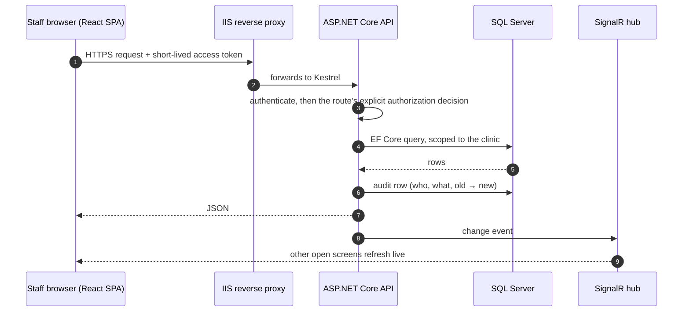

### מהפנייה הראשונה ועד מטופל

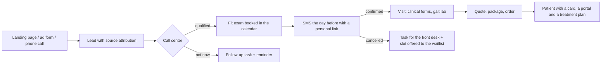

---

## 📐 פרמטרים טכניים

| פרמטר | ערך |
|---|---|
| סביבת ריצה | ‎.NET 10 LTS, ‏ASP.NET Core Web API על Kestrel מאחורי IIS כ-reverse proxy |
| גישה לנתונים | Entity Framework Core, מיגרציות code-first, ‏SQL Server |
| זמן אמת | SignalR |
| צד לקוח | React 19, TypeScript, Vite, MUI, ‏design tokens לבהיר ולכהה, RTL מלא |
| שטח ה-API | יותר מ-140 בקרים, החלטת הרשאה מפורשת לכל נתיב |
| מודל הדומיין | יותר מ-110 ישויות, תיחום נתונים לפי מרפאה |
| שטח הממשק | כ-100 מסכים מנותבים, כולל הדפים הציבוריים ודפי המטופל |
| סשנים | access token ו-refresh token ברוטציה · נעילת מסך אחרי 15 דקות · סיום סשן אחרי 8 שעות |
| כניסה לפורטל | תעודת זהות וקוד חד-פעמי, בתוקף 5 דקות ולשימוש אחד |
| מסמכים | PDF נעול עם טביעת SHA-256 · ייצוא Word פתוח לעריכה |
| דפי נחיתה | 26 רכיבים, הדף שמתפרסם זהה לעורך במחשב ובנייד |
| סודות | מוצפנים במנוחה במנגנון הגנת הנתונים של מערכת ההפעלה, ולא נשמרים בבקרת הגרסאות |
| גיבויים | גיבוי מלא כל לילה, ונוהל שחזור שתורגל בפועל |
| שערי איכות | GitHub Actions CI · xUnit · בדיקות קצה לקצה ב-Playwright בדפדפן אמיתי · אימות מול מסד בדיקות נפרד · בדיקה אחרי התקנה עם חזרה אוטומטית לאחור |
| הדרכה | מדריך מובנה עם 47 שיעורים |

---

## 🔐 אבטחה ופרטיות מהיסוד

- הרשאות לפי תפקיד, קבוצה ומשתמש, שנאכפות בשרת. הסתרת כפתור היא תוספת, לא הבקרה עצמה.
- כל שינוי נרשם עם הערך הישן והחדש, וכל פתיחה של כרטיס מטופל מתועדת.
- מחיקות עוברות לסל מחזור וניתנות לשחזור. כללי שמירת המידע מוגדרים לכל סוג נתון ונסקרים במסך ייעודי.
- קוד הכניסה לפורטל חד-פעמי ופג אחרי חמש דקות, וכל מטופל רואה רק את הנתונים שלו.
- לשליחת הודעות יש מתג מרכזי, חלון שעות מותר ויומן הודעות מלא עם דוחות מסירה.
- הצהרות פרטיות, עוגיות ונגישות הן חלק מכל דף ציבורי.

## 🧪 איך היא נבנית

אני עובד עם סוכני AI לפיתוח, לפי כללים שכתבתי לפרויקט ושנאכפים על כל שינוי:

1. **אין "תוקן" בלי ראיה.** צילום מסך, תוצאת שאילתה או בדיקה שעוברת. בלי זה הפריט נשאר "בנוי, לא אומת".
2. **משחזרים בדפדפן אמיתי.** "נראה תקין בקוד" לא נחשב. Playwright מפעיל את המסך עצמו.
3. **הרצה יבשה ודרך חזרה לפני כל שינוי בנתונים.** קודם שאילתה של לפני ואחרי ופקודת ביטול.
4. **רשימה אחת.** כל בקשה נמצאת ברשימת מעקב אחת, עם המצב שלה ועם הראיה.
5. **התקנה לא הסתיימה עד שהאתר החי מוכיח אותה.** אחרי כל גרסה סקריפט ההתקנה מושך את הדפים הציבוריים, ומחזיר לאחור עם קוד יציאה אמיתי אם בדיקה נכשלת.

## 👤 התפקיד שלי

אני מנהל ה-IT של רשת המכונים, ותכננתי ובניתי את המערכת: אפיון מול הצוות, מודל הנתונים, צד השרת, צד הלקוח, מערכת העיצוב, האינטגרציות, ההתקנה על שרתי הארגון, הגיבויים והגרסאות השוטפות.

## 📌 מצב

המערכת מבצעית: מותקנת על שרתי הארגון מיולי 2026, והצוותים עובדים בה. הפיתוח נמשך בגרסאות סדירות ומאומתות.

---

**Built by [Gal Asulin](https://github.com/galasulin), IT Manager**

לא מתפרסמים כאן קוד מקור, סכמה, סודות או נתונים אמיתיים. השם והלוגו של AposTherapy שייכים לבעליהם.

