

  <a href="https://galasulin.github.io/clinic-crm/">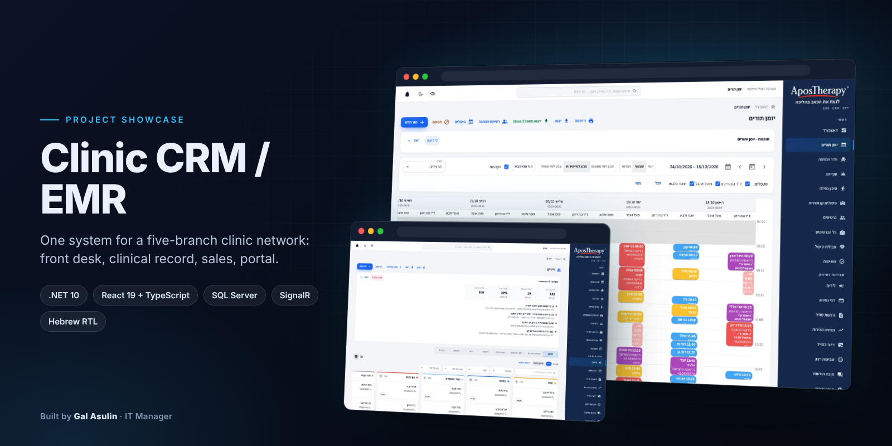</a>

<h1 align="center">Clinic CRM / EMR</h1>

  <b>One system that runs a five-branch clinic network: front desk, call center, clinical record, sales, marketing and a patient portal.</b> 
  Designed and built end to end by one person. Self-hosted. Hebrew RTL first.

  <b>🇬🇧 English</b> · <a href="README.he.md">🇮🇱 עברית</a>

  <a href="https://galasulin.github.io/clinic-crm/"><b>▶ Live page: 2:18 trailer + screens</b></a> ·
  <a href="#-screens">Screens</a> ·
  <a href="#-what-makes-it-different">What makes it different</a> ·
  <a href="#-architecture">Architecture</a> ·
  <a href="#-technical-parameters">Technical parameters</a>

  
  
  
  
  
  
  
  

> 🔒 **Showcase, not source.** The code and all real data are private. Every screen and the trailer were captured from an **isolated local demo instance** built from the production code, seeded with invented people and numbers, with SMS, e-mail and WhatsApp sending disabled. Nothing here comes from production.

---

## 📊 At a glance

| | |
|---|---|
| **What** | CRM + EMR + front desk + patient portal for a multi-branch physiotherapy clinic network |
| **Status** | Operational: installed in production since July 2026, the teams work in it |
| **Scale of the build** | 140+ API controllers · 110+ domain entities · about 100 screens · 26 landing-page blocks · 47 in-app lessons |
| **Stack** | ASP.NET Core Web API on .NET 10 LTS · EF Core · SQL Server · SignalR · React 19 · TypeScript · Vite · MUI |
| **Hosting** | Self-hosted on the clinic's own Windows servers, IIS reverse proxy in front of Kestrel |
| **Languages** | Hebrew (RTL) first, light and dark themes from one design-token layer |
| **My role** | Everything: requirements, data model, backend, frontend, design system, integrations, deployment, backups |
| **Delivery record** | 1,305 tracked requirements · 876 closed with live evidence · 194 more proven in an isolated environment (November 2026) |

---

## 📸 Screens

<table>
<tr>
<td width="25%" valign="top"><a href="assets/screens/01-home_light.webp">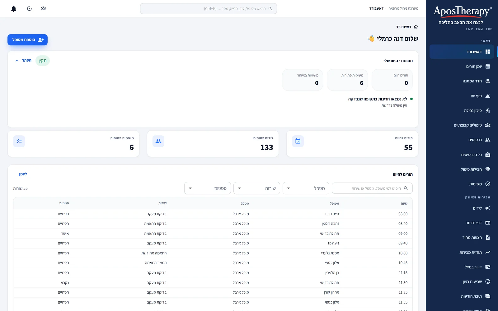</a> <b>Dashboard</b> Today's appointments, tasks and leads.</td>
<td width="25%" valign="top"><a href="assets/screens/02-schedule_week_light.webp">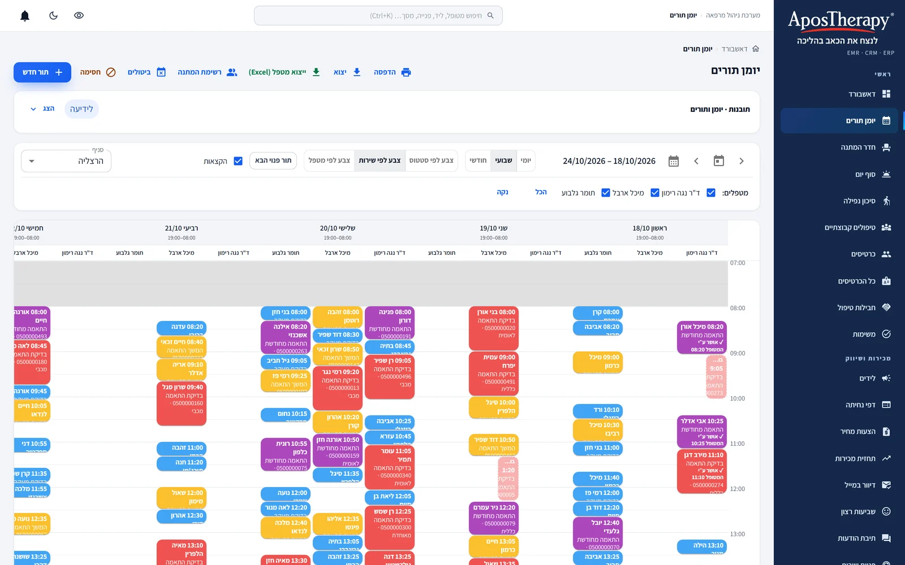</a> <b>Calendar</b> By therapist, room and branch. Drag to move.</td>
<td width="25%" valign="top"><a href="assets/screens/03-patient_light.webp">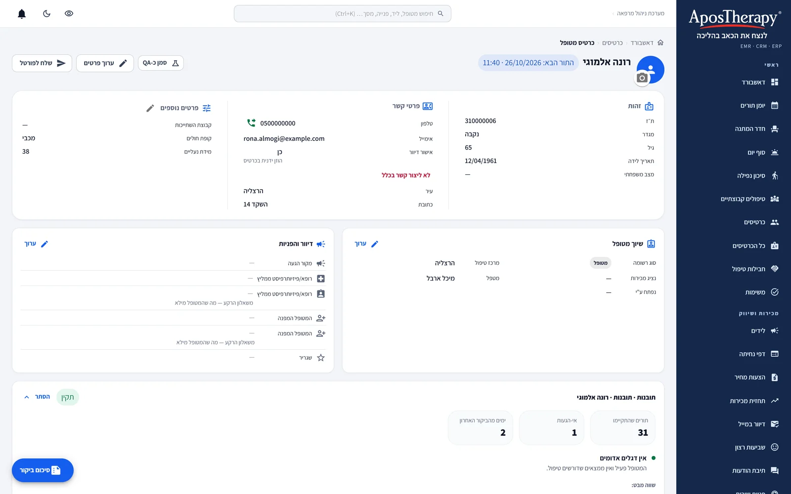</a> <b>Patient card</b> One search opens the whole card.</td>
<td width="25%" valign="top"><a href="assets/screens/06-leads_kanban_light.webp">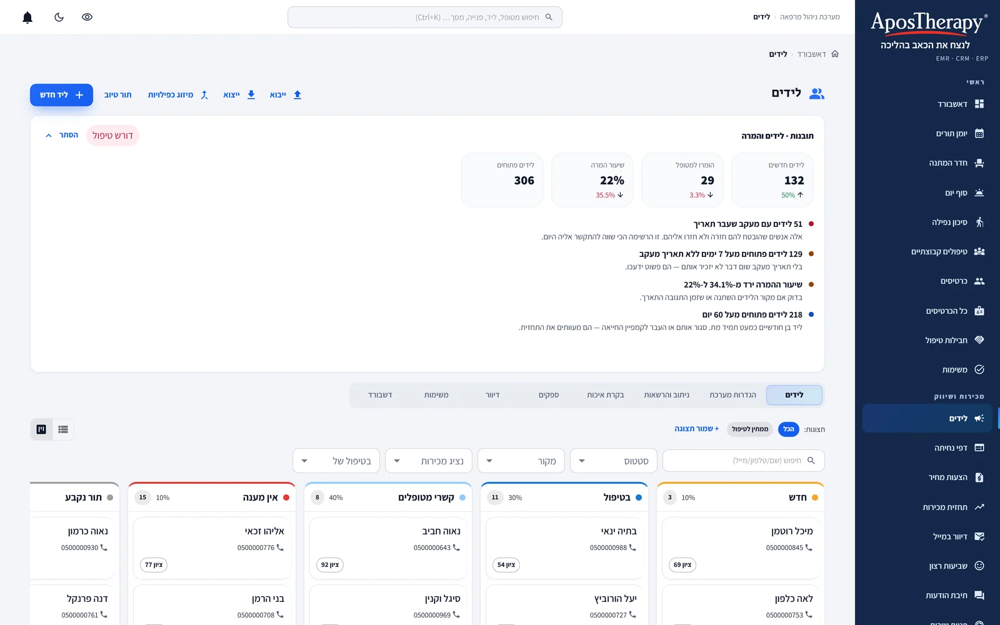</a> <b>Leads</b> List or board, by sales stage.</td>
</tr>
<tr>
<td width="25%" valign="top"><a href="assets/screens/07-gait_compare_light.webp">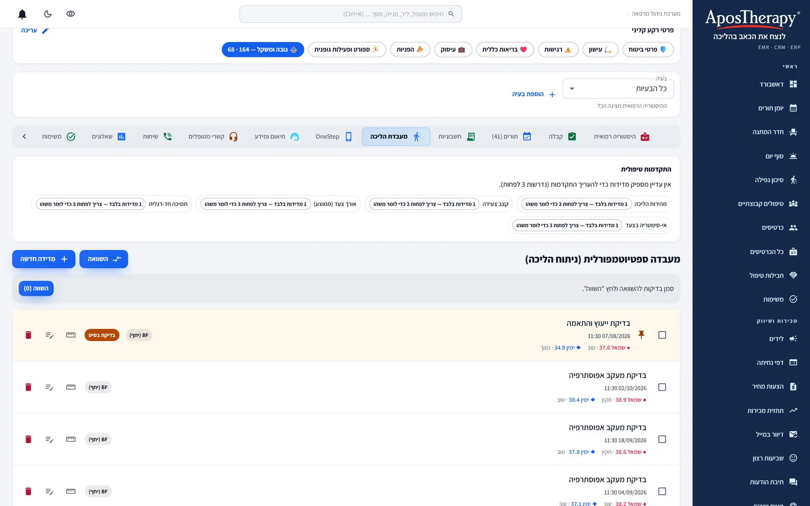</a> <b>Gait lab</b> Every measure against the norm and the baseline.</td>
<td width="25%" valign="top"><a href="assets/screens/08-form_builder_light.webp">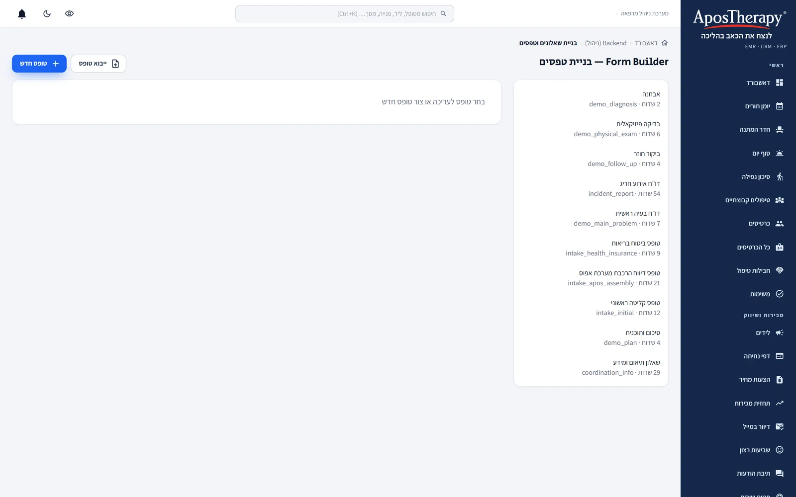</a> <b>Clinical forms</b> Fields, required fields, signature.</td>
<td width="25%" valign="top"><a href="assets/screens/04-sales_forecast_light.webp">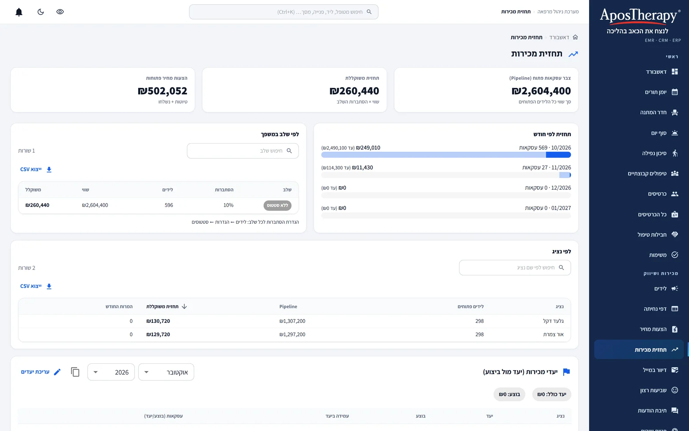</a> <b>Sales forecast</b> Every deal weighted by probability.</td>
<td width="25%" valign="top"><a href="assets/screens/05-access_light.webp">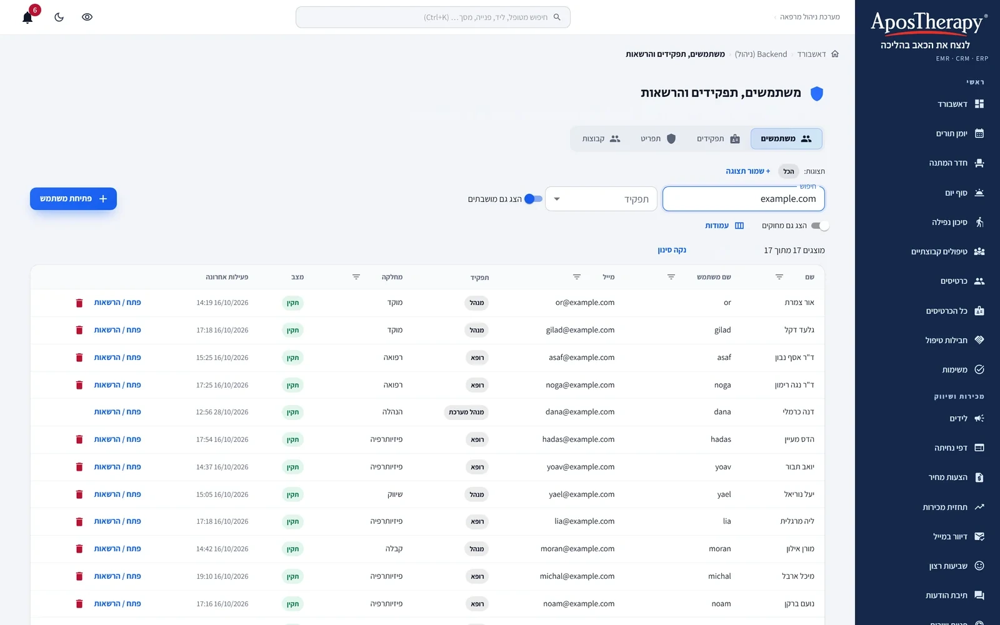</a> <b>Users and permissions</b> By role, group and user.</td>
</tr>
</table>

Click a screen for full size. The <a href="https://galasulin.github.io/clinic-crm/">live page</a> has the launch trailer (preview, work in progress).

---

## 🚀 What makes it different

Most clinics run a scheduling tool, a separate medical record, a separate lead tool, a spreadsheet for sales and a phone system that knows nothing about any of them. This system replaces all of them with one data model.

| | What it means in practice |
|---|---|
| **Engines, not screens** | Clinical forms, the narrative text they produce, automations, document templates, reports and landing pages are all **data**, edited in the settings screens. A new form or a new report needs no code and no release. |
| **Clinical and commercial in one record** | The same person moves from lead to prospective customer to patient **without retyping**. The call that created the lead, the campaign that paid for it, the visits, the gait measurements and the package they bought sit on one timeline. |
| **Forms that write the clinical text** | A clinician answers structured questions; the engine composes a flowing Hebrew clinical narrative from the answers (placeholders, conditional sentences, loops). The text stays editable, signable and exportable. |
| **A gait lab inside the record** | Gait measures are stored per exam and judged against clinical norms; follow-up exams are compared with the baseline, side by side. Measurements from the patient's motion-analysis phone app land on the same card. |
| **Telephony that knows the patient** | Every inbound and outbound call from the cloud PBX is linked to the patient or lead card, with click-to-call from the card. |
| **Marketing closed-loop** | A drag-and-drop landing-page builder publishes pages that post leads straight into the pipeline with their ad source; lead-stage events go back to the ad platform through its Conversions API. |
| **Security decided per route** | Every API route carries an explicit, tested authorization decision. Every change and every opening of a patient card is audited. Every delete is recoverable. |
| **Evidence before "done"** | Nothing is closed without a screenshot, a query result or a passing test. Each release passes CI, a run against a separate database and an automatic post-deploy check that rolls back on failure. |

---

## ✅ Capabilities

**Front desk and call center**
- A calendar by therapist, room and branch; a day view by room (including the gait lab); drag an appointment to a free slot; a small month calendar that jumps to a day; one button finds the next free slot.
- Five branches, each with its own opening hours and one-off exceptions.
- A waiting-room board: who has arrived, how long they have been waiting, and who is in treatment.
- An SMS the day before for appointments booked in the system, with a personal link to confirm, add to the phone calendar, open navigation, or cancel. A cancellation from the link opens a follow-up task, and every cancellation is listed with its reason and what was already handled.
- A slot that opens up is offered to a waiting patient through a personal link.
- Every call from the cloud PBX, inbound and outbound, linked to the patient or lead card.
- Team tasks and follow-ups, including what is overdue.

**Clinicians**
- One search box, and the patient card opens.
- The record is organised by problem (for example, right knee), and filling a clinical form writes the narrative summary.
- Clinical forms with fields, required fields and a signature field.
- Gait measurements against the norm (normal / good / low), and comparison of follow-up exams against the baseline exam.
- Measurements from the patient's motion-analysis phone app on the card, and a list of patients who stopped measuring.
- Visit documents exported as a locked PDF with a SHA-256 fingerprint, plus an editable Word file.
- End of day: what still waits for documentation.

**Sales and marketing**
- Every lead with its source, down to the referring doctor; leads from landing pages arrive directly with their source.
- A pipeline as a list or a board by sales stage; from lead to customer and patient without retyping.
- A drag-and-drop landing-page editor with 26 blocks; the published page is identical to the editor on desktop and mobile; registrants with their ad source, exportable to Excel.
- Campaign budget, cost per lead and conversion rate.
- Quotes and orders (what was sent, what was approved), treatment packages with usage and renewals.

**Management**
- A manager dashboard: leads, conversions and workload on one screen.
- A report builder over any value in the system, with saved reports.
- A sales forecast that weights every deal by its probability.

**Patients**
- A personal portal: sign in with ID number and a one-time code (valid 5 minutes, single use); each patient sees only their own data.
- The background questionnaire filled from the phone, straight into the card.
- Privacy, cookie and accessibility statements on every page.

**Security and reliability**
- Permissions by role, group and user; which leads each role sees is enforced on the server.
- Every API route has an explicit, tested authorization decision; two-step sign-in.
- Every change and every opening of a patient card is written to an audit log.
- The screen locks after 15 minutes idle and the session ends after 8 hours.
- Every delete goes to a recycle bin and can be restored.
- A full backup every night, and a restore that was actually tested.
- A built-in guide with 47 lessons.

**Also in the system**
- AI interpretation of fall-risk measurements, shown to the clinician as a non-binding suggestion.
- WhatsApp conversations answered from the shared inbox.
- A freed slot handed over automatically to the next patient on the waiting list.
- Invoice allocation numbers against the tax authority's service.
- A post-visit satisfaction survey.

---

## 🧩 Module map

| Area | Modules |
|---|---|
| **Front desk** | Calendar (week, day by room, month) · rooms and stations · branch hours, holidays and closed days · waiting-room board · waiting list · cancellations board · reminders |
| **Clinical** | Patient card · problem-oriented record · form builder and clinical note templates · body chart · gait lab · fall-risk measurements · questionnaires · visit summary (PDF / Word) · patient documents and files · group sessions |
| **Call center and service** | Call log with card linking · shared inbox · service cases · tasks and follow-ups · "my day" |
| **Sales** | Leads (list and board) · lead sources and referring doctors · quotes · contracts · treatment packages · price lists · sales forecast · approvals |
| **Marketing** | Landing-page builder, media library and registrants · campaigns with cost per lead · e-mail campaigns · conversion events to the ad platform |
| **Finance and stock** | Invoices and receipts · legal entities · receivables aging · therapist earnings · inventory · purchasing |
| **Management** | Manager dashboard · custom dashboards and widgets · report builder with saved and shared reports · insights |
| **Patient-facing** | Portal (ID number + one-time code) · appointment confirm / cancel links · waiting-list offer links · questionnaires from the phone · privacy, cookie and accessibility statements |
| **Platform** | Users, roles, groups and permissions · audit log and sign-in events · sessions · data-retention rules and review · recycle bin · privacy requests · feature switches · message templates and catalogue · automations · monitoring and control center · API keys and webhooks · built-in training guide |

---

## 🧱 Architecture

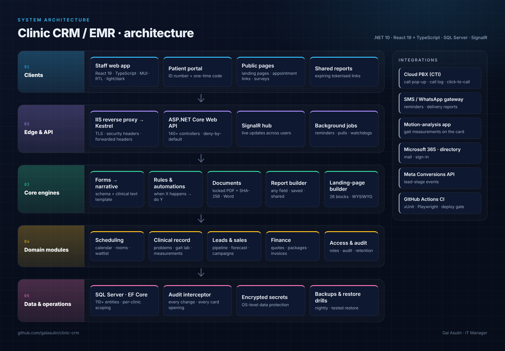

**Clean Architecture** in three projects: `Api` (controllers, authorization, real-time hub), `Core` (entities, rules, engines) and `Infrastructure` (EF Core, integrations, jobs). A React single-page app sits on top and SQL Server underneath. The whole system is self-hosted on Windows: IIS terminates TLS and proxies to Kestrel.

- **Authentication.** Short-lived JWT access tokens with refresh-token rotation, an optional second step at sign-in, an idle screen lock after 15 minutes and a hard session end after 8 hours.
- **Authorization.** Deny by default. Each route declares its decision, and the decisions are covered by tests. Which leads a role may see is filtered on the server, not in the UI.
- **Audit.** An EF Core interceptor writes who, what, when and old → new for every entity change; opening a patient card is logged as well. Secrets are redacted before they reach the log.
- **Real time.** A SignalR hub pushes change events, so calendars, boards and the waiting room refresh across users without a reload.
- **Background work.** A job engine sends reminders inside an allowed time window, pulls delivery reports and inbound messages, imports call records and runs watchdogs that alert on CPU, memory, disk, certificate, backup and outage events.
- **Engines.** Form definitions hold a field schema and a narrative template. Rules map events to actions. Document templates merge card, visit and form data into a locked PDF with a SHA-256 fingerprint or an editable Word file.

### Request path

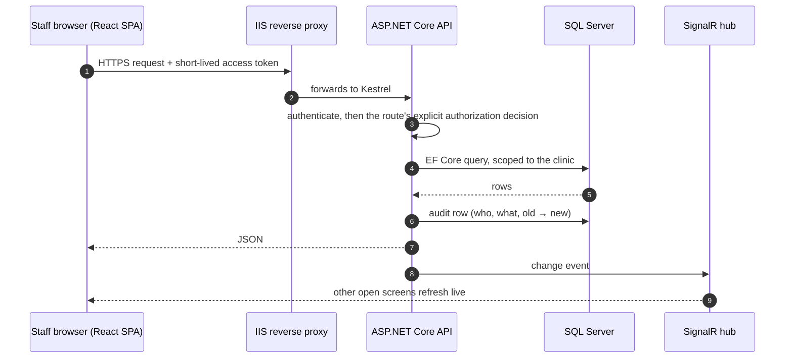

### From first contact to patient

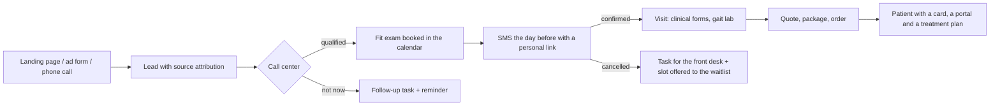

---

## 📐 Technical parameters

| Parameter | Value |
|---|---|
| Runtime | .NET 10 LTS, ASP.NET Core Web API on Kestrel behind an IIS reverse proxy |
| Data access | Entity Framework Core, code-first migrations, SQL Server |
| Real time | SignalR |
| Frontend | React 19, TypeScript, Vite, MUI, design tokens for light and dark, full RTL |
| API surface | 140+ controllers, explicit authorization decision on every route |
| Domain model | 110+ entities, per-clinic data scoping |
| UI surface | About 100 routed screens, including public and patient-facing pages |
| Sessions | Access token + rotating refresh token · screen lock after 15 min idle · session end after 8 h |
| Portal sign-in | ID number + one-time code, valid 5 minutes, single use |
| Documents | Locked PDF with SHA-256 fingerprint · editable Word export |
| Landing pages | 26 blocks, WYSIWYG parity between editor and published page on desktop and mobile |
| Secrets | Encrypted at rest with the operating system's data-protection API, never in source control |
| Backups | Full nightly backup, restore procedure exercised in practice |
| Quality gates | GitHub Actions CI · xUnit · Playwright end-to-end in a real browser · verification on a separate test database · post-deploy check with automatic rollback |
| Training | Built-in guide with 47 lessons |

---

## 🔐 Security and privacy by design

- Permissions by role, group and user, enforced on the server. Hiding a button is an addition, never the control.
- Every change is audited with old and new values; every opening of a patient card is recorded.
- Deletes go to a recycle bin and can be restored. Retention rules are defined per data type and reviewed in a dedicated screen.
- One-time portal codes are single use and expire after five minutes; each patient sees only their own data.
- Outbound messaging has a central switch, an allowed time window and a full message log with delivery reports.
- Privacy, cookie and accessibility statements are part of every public page.

## 🧪 How it is built

I work with AI coding agents under rules I wrote for this project and enforce on every change:

1. **No "fixed" without evidence.** A screenshot, a query result or a passing test, or the item stays "built, not verified".
2. **Reproduce in a real browser.** "Looks fine in the code" does not count; Playwright drives the actual screen.
3. **Dry run and undo before any data change.** A before and after query, and a rollback command, come first.
4. **One list.** Every request lives in a single tracked checklist with its state and its evidence.
5. **A deploy is not done until the live site proves it.** After each release the deploy script fetches the public pages and rolls back with a real exit code if any check fails.

## 👤 My role

I am the IT manager of the clinic network, and I designed and built this system: requirements with the clinic staff, data model, backend, frontend, design system, integrations, deployment on the clinic's own servers, backups, and the ongoing releases.

## 📌 Status

The system is operational: installed on the clinic's servers since July 2026, with the teams working in it. Development continues in regular, verified releases.

---

**Built by [Gal Asulin](https://github.com/galasulin), IT Manager**

No source code, schema, secrets or real data are published here. The AposTherapy name and logo belong to their owner.

