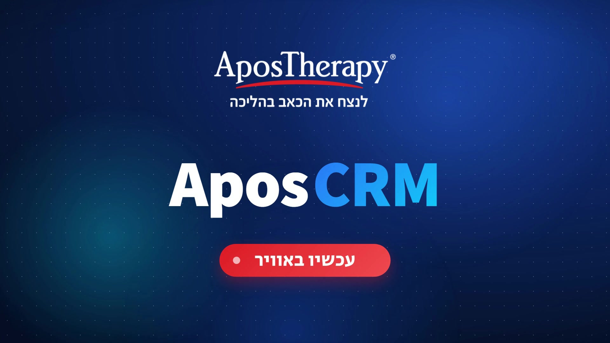
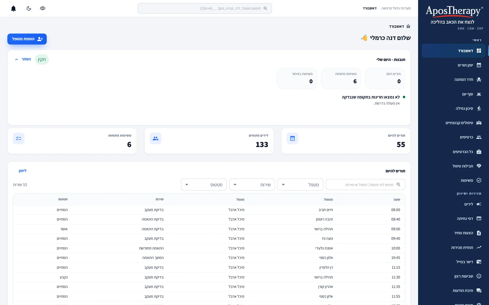
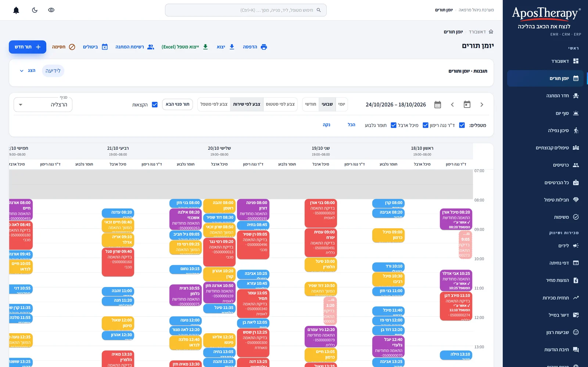
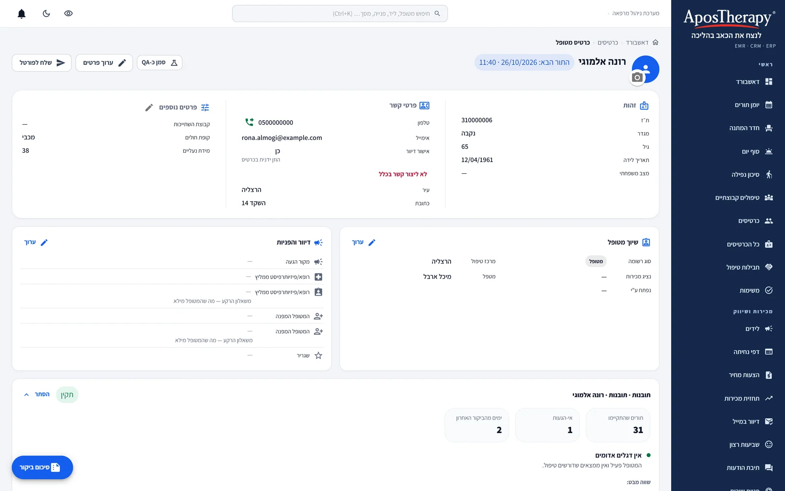
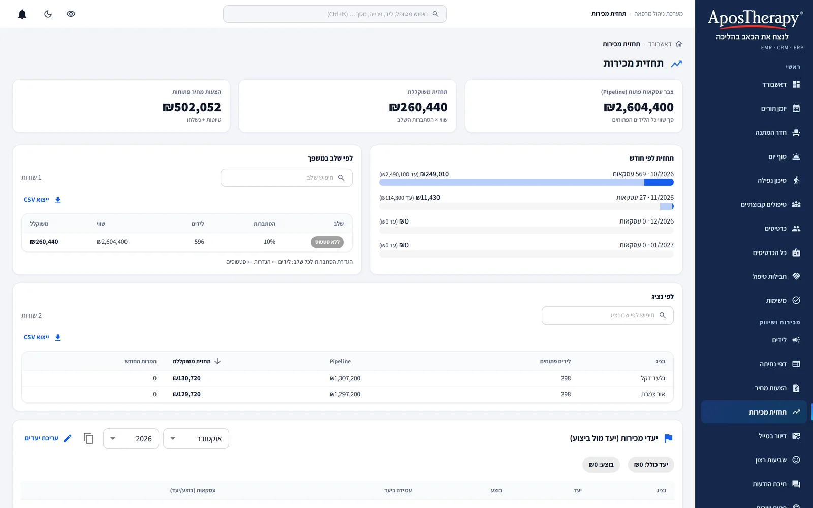
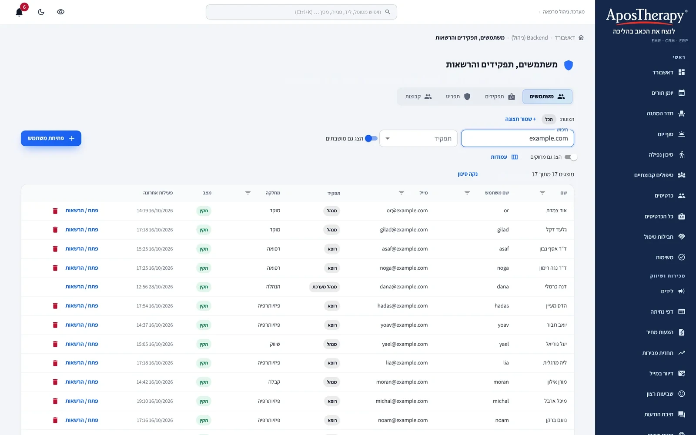
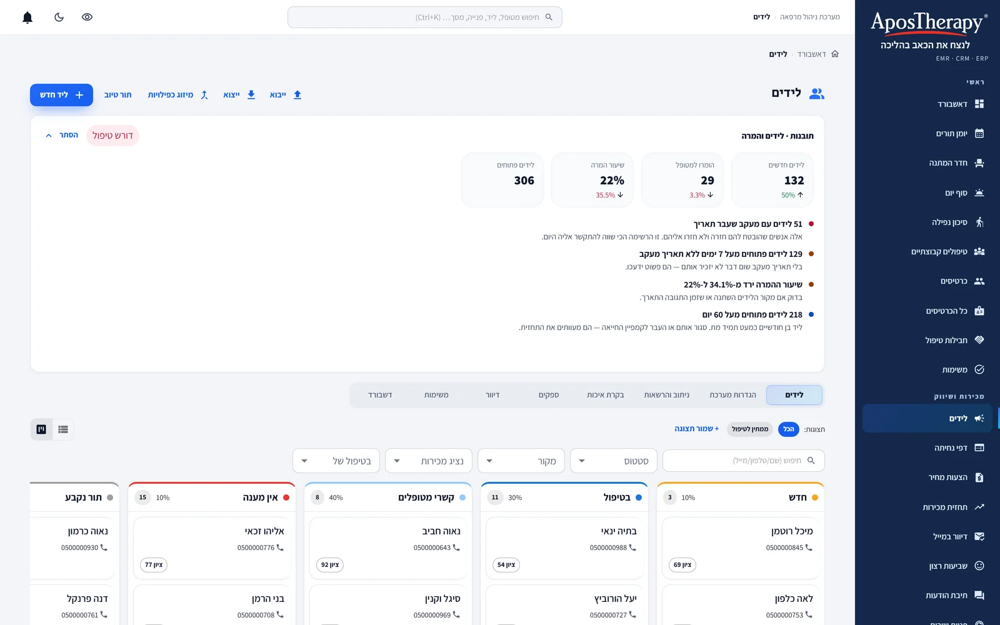
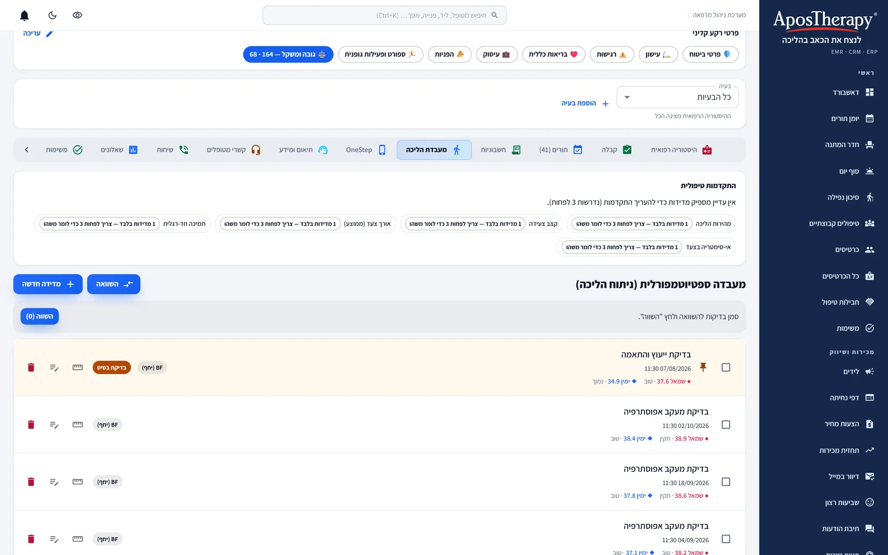
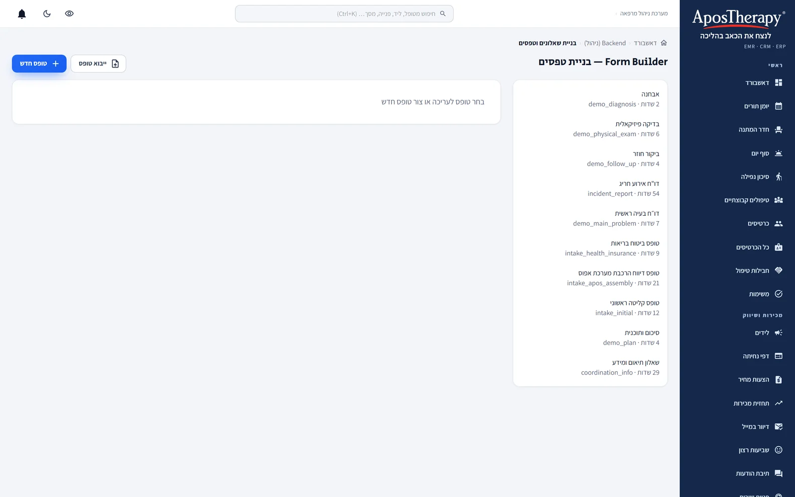
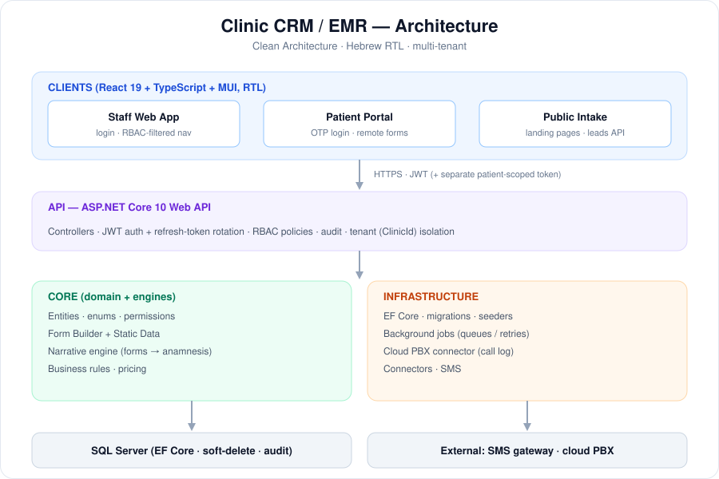

# 🏥 Clinic CRM / EMR · Project Showcase

  
   <b>▶ Launch trailer · Preview — work in progress.</b> Click to play it on the <a href="https://galasulin.github.io/clinic-crm/">live page</a> (84 s, Hebrew / English subtitles).

  <a href="README.he.md">🇮🇱 עברית</a> ·
  <a href="https://galasulin.github.io/clinic-crm/">Live page: trailer + 8 screens</a>

A clinic management system (CRM + EMR) that I designed and built end to end for a multi-branch physiotherapy clinic network. It replaced paper, phone notes and spreadsheets with **one system for the whole clinic**, and it runs in production every day.

> 🔒 **Showcase, not source.** The code and all real data are private. Every screen and the trailer were captured from an **isolated local demo instance** built from the production code, seeded with invented people and numbers, with SMS, e-mail and WhatsApp sending disabled. Nothing here comes from production.

---

## 🖥️ Screens

| | |
|---|---|
|  **Dashboard** · the morning starts on one screen: today's appointments, tasks and leads. |  **Calendar** · by therapist, room and branch; an appointment moves by drag and drop. |
|  **Patient card** · one search, and the whole card is open. |  **Sales forecast** · every deal weighted by its probability. |
|  **Users and permissions** · by role, group and user. |  **Leads** · list or board, by sales stage. |
|  **Gait lab** · every gait measure against the norm, follow-ups against the baseline. |  **Clinical forms** · fields, required fields and a signature field. |

---

## ✅ What runs in production

Only capabilities that are live and were closed with evidence. Features that are built but switched off are not listed.

**Front desk and call center**
- A calendar by therapist, room and branch; a day view by room (including the gait lab); drag an appointment to a free slot; a small month calendar that jumps to a day; one button finds the next free slot.
- Five branches, each with its own opening hours and one-off exceptions.
- A waiting-room board: who has arrived, how long they have been waiting, and who is in treatment.
- An SMS the day before for appointments booked in the system, with a personal link to confirm, add to the phone calendar, open navigation, or cancel. A cancellation from the link opens a follow-up task, and every cancellation is listed with its reason and what was already handled.
- A slot that opens up is offered to a waiting patient through a personal link.
- Every call from the cloud PBX, inbound and outbound, linked to the patient or lead card.
- Team tasks and follow-ups, including what is overdue.

**Clinicians**
- One search box, and the patient card opens.
- The record is organised by problem (for example, right knee), and filling a clinical form writes the narrative summary.
- Clinical forms with fields, required fields and a signature field.
- Gait measurements against the norm (normal / good / low), and comparison of follow-up exams against the baseline exam.
- Measurements from the patient's motion-analysis phone app on the card, and a list of patients who stopped measuring.
- Visit documents exported as a locked PDF with a SHA-256 fingerprint, plus an editable Word file.
- End of day: what still waits for documentation.

**Sales and marketing**
- Every lead with its source, down to the referring doctor; leads from landing pages arrive directly with their source.
- A pipeline as a list or a board by sales stage; from lead to customer and patient without retyping.
- A drag-and-drop landing-page editor with 26 blocks; the published page is identical to the editor on desktop and mobile; registrants with their ad source, exportable to Excel.
- Campaign budget, cost per lead and conversion rate.
- Quotes and orders (what was sent, what was approved), treatment packages with usage and renewals.

**Management**
- A manager dashboard: leads, conversions and workload on one screen.
- A report builder over any value in the system, with saved reports.
- A sales forecast that weights every deal by its probability.

**Patients**
- A personal portal: sign in with ID number and a one-time code (valid 5 minutes, single use); each patient sees only their own data.
- The background questionnaire filled from the phone, straight into the card.
- Privacy, cookie and accessibility statements on every page.

**Security and reliability**
- Permissions by role, group and user; which leads each role sees is enforced on the server.
- Every API route has an explicit, tested authorization decision; two-step sign-in.
- Every change and every opening of a patient card is written to an audit log.
- The screen locks after 15 minutes idle and the session ends after 8 hours.
- Every delete goes to a recycle bin and can be restored.
- A full backup every night, and a restore that was actually tested.
- A built-in guide with 47 lessons.

---

## 🏗️ Architecture

Clean Architecture split into **Api / Core / Infrastructure**, a React SPA on top and SQL Server underneath, self-hosted on Windows. JWT authentication with refresh-token rotation, deny-by-default authorization, and live updates across users.

## 🛠️ Stack

- **Backend:** ASP.NET Core Web API on .NET 10 LTS, EF Core, SQL Server, SignalR for live updates.
- **Frontend:** React 19 + TypeScript + Vite + MUI, fully right-to-left, driven by a design-token layer in light and dark.
- **Quality:** GitHub Actions CI, xUnit tests, end-to-end checks in a real browser with Playwright, and every release verified on a separate test database before it goes live.

## 👤 My role

I am the IT manager of the clinic network, and I designed and built this system: requirements with the clinic staff, data model, backend, frontend, design system, integrations, deployment on the clinic's own servers, backups, and the ongoing releases.

## 📌 Status

In production since July 2026, in daily use by the front desk, the call center, clinicians and management. Development continues in regular, verified releases.

---

**Built by [Gal Asulin](https://github.com/galasulin), IT Manager**

No source code, schema, secrets or real data are published here. The AposTherapy name and logo belong to their owner.

